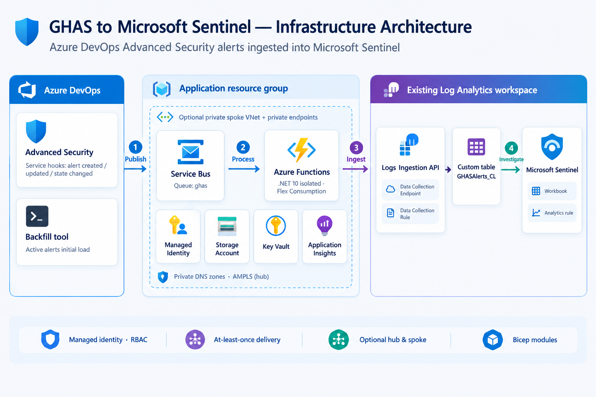

# GitHub Advanced Security to Microsoft Sentinel

This project forwards Azure DevOps Advanced Security alert events to a Service Bus queue, normalizes them in a .NET isolated Azure Function, and ingests records into an existing Microsoft Sentinel workspace through the Logs Ingestion API. It also includes an active-alert backfill tool, service-hook setup script, a Sentinel workbook, and an optional scheduled analytics rule.

The workspace is intentionally parameterized. No Azure resource or Azure DevOps project is modified until an operator runs the deployment or service-hook commands.

## Architecture



1. Three Advanced Security service-hook events publish JSON to the `ghas` queue.
2. The Function consumes the queue with a user-assigned managed identity and uploads normalized records to `GHASAlerts_CL`.
3. `Ghas.Sentinel.Backfill` can page through active repository alerts and enqueue deterministic `InitialLoad` messages.
4. The `GitHub Advanced Security alerts` workbook shows alert triage by default; the `Show operational panels` workbook parameter enables Function and Service Bus diagnostics.
5. An optional Sentinel scheduled rule creates incidents for new or backfilled active secret alerts.

Queue messages are processed at least once. The DCR ingestion API doesn't guarantee exactly-once writes; consumers should deduplicate using `EventId`. The workbook presents the latest event by repository, alert, and branch.

`infra/main.bicep` orchestrates single-component modules in `infra/modules/`. `infra/workspace.bicep` orchestrates the Sentinel components in the existing workspace subscription and resource group. Entry-point parameters, outputs, and resource names are preserved.

| Folder | Modules |
| --- | --- |
| `identity/` | `user-assigned-identity` |
| `storage/` | `storage-account` (with deployment container), `storage-role-assignment` |
| `messaging/` | `service-bus-namespace`, `service-bus-queue` (with send-only rule), `service-bus-queue-role-assignment`, `service-bus-diagnostics` |
| `compute/` | `flex-consumption-plan`, `function-app` (with app settings) |
| `monitoring/` | `application-insights` |
| `security/` | `key-vault` |
| `networking/` | `private-endpoint` (with DNS zone group), `monitor-private-link-scoped-resource` |
| `sentinel/` | `custom-table`, `data-collection-endpoint`, `data-collection-rule`, `data-collection-rule-role-assignment`, `analytics-rule`, `workbook` |

## Prerequisites

- .NET 10 SDK and Azure Functions Core Tools v4.
- Azure CLI and Azure Developer CLI (`azd`).
- An existing Sentinel-enabled Log Analytics workspace.
- For deployment, permissions to create resources and role assignments in the app resource group, and to create a custom table, DCR, workbook, and (optionally) analytics rule in the workspace resource group.
- For service hooks, an Azure DevOps Services PAT with project service-hook administration and Advanced Security access.

## Configure and deploy with azd

Create an azd environment and set the application deployment target and existing workspace coordinates:

```powershell
azd env new dev
azd env set AZURE_SUBSCRIPTION_ID <application-subscription-id>
azd env set AZURE_LOCATION <application-region>
azd env set SENTINEL_WORKSPACE_SUBSCRIPTION_ID <workspace-subscription-id>
azd env set SENTINEL_WORKSPACE_RESOURCE_GROUP <workspace-resource-group>
azd env set SENTINEL_WORKSPACE_NAME <workspace-name>
azd env set SENTINEL_WORKSPACE_REGION <workspace-region>
```

Optional switches:

```powershell
azd env set ENABLE_ANALYTICS_RULE true
```

Set this value explicitly to `true` or `false` before provisioning; `true` creates the scheduled secret-alert rule.

`azd up` provisions the Bicep resources and deploys the Function. Provisioning includes a queue-scoped `sendOnly` SAS rule for service-hook SAS mode and a Key Vault with RBAC enabled. The Function uses managed identity for host storage, Service Bus receive, and DCR publishing. Its Application Insights component writes to the selected Sentinel workspace.

The deployment uses a cross-resource-group module for the existing workspace. The deploying identity must have the needed access in both subscriptions if the workspace is in a different subscription. Keep the Function app region and workspace/DCR region aligned where required by Azure Monitor.

## Optional private hub & spoke integration

Omit `privateNetwork` (or set it to `null`) to keep the current public deployment. Supplying this typed object enables integration with an **existing** hub & spoke landing zone; the template does not create or overwrite VNets, subnets, peerings, routes, firewalls, DNS zones, VNet links, or the shared Azure Monitor Private Link Scope (AMPLS).

| Component | Private mode |
| --- | --- |
| Flex Consumption Function | Outbound VNet integration and an inbound `sites` private endpoint; public access disabled. |
| Function storage | Blob, Queue, and Table private endpoints; public access and shared-key access disabled. Flex Consumption does not need an Azure Files endpoint. |
| Service Bus | **Premium, one messaging unit** (additional cost), with a namespace private endpoint. Public access disabled unless explicitly opted in. |
| Key Vault | Vault private endpoint and public access disabled. Private mode enables purge protection, which cannot subsequently be disabled. Public mode leaves the existing purge-protection setting unchanged. |
| Azure Monitor | Private DCE in the workspace region, attached to the DCR; the Function publishes to the DCE, not the public DCR endpoint. The DCE and Application Insights are linked to the existing AMPLS. Application Insights public ingestion and query are disabled. |

### Landing-zone prerequisites

- Two **different existing subnets** in the application region: a Function integration subnet delegated to `Microsoft.App/environments` (recommended `/27` or larger for one app), and a nondelegated private-endpoint subnet with at least six available addresses. Do not share the integration subnet with Container Apps or private endpoints. Register `Microsoft.App` in the application subscription; for cross-subscription VNet integration, register `Microsoft.Web` in the VNet subscription.
- Existing private DNS zones for `privatelink.blob.core.windows.net`, `privatelink.queue.core.windows.net`, `privatelink.table.core.windows.net`, `privatelink.servicebus.windows.net`, `privatelink.vaultcore.azure.net`, and `privatelink.azurewebsites.net`. Supply their full resource IDs, including centralized zones in another resource group/subscription. The template creates DNS zone groups on its endpoints, not the zones or VNet links. Avoid duplicate zone-group ownership if Azure Policy already deploys these groups.
- The spoke must resolve those zones through VNet links or the hub's DNS forwarding/Azure DNS Private Resolver. Peering alone does not provide DNS resolution. Verify both the Function hostname and its `scm` deployment hostname resolve to the private endpoint.
- An existing AMPLS with an approved private endpoint reachable from the spoke and the Azure Monitor private DNS zones configured (`privatelink.monitor.azure.com`, `privatelink.oms.opinsights.azure.com`, `privatelink.ods.opinsights.azure.com`, `privatelink.agentsvc.azure-automation.net`, and the applicable storage zone). The **existing Sentinel workspace must already be linked to this AMPLS**; the template only adds its new DCE and Application Insights links.
- **Shared workspace policy is intentionally not changed.** The workspace owner must disable public ingestion/query as appropriate and configure AMPLS ingestion/query access modes if the entire workspace must be private-only. Adding an AMPLS association alone does not block public ingestion, including the direct DCR endpoint retained for compatibility. Assess other workspace consumers before changing this shared policy.
- Existing NSGs/UDRs must allow DNS to the chosen resolver, HTTPS (443) to Storage, Key Vault and Monitor, and AMQP TLS (5671) to Service Bus. Flex Consumption already routes all outbound traffic through the integration subnet; configure the existing UDR to the hub firewall and allow required platform/identity/deployment endpoints. Private endpoints do not eliminate every platform egress dependency.
- The deployment identity needs subnet join and private-endpoint permissions, private DNS zone-group/zone join permissions, and permission to add scoped resources to AMPLS, including across resource groups/subscriptions. Run deployment, Function publishing, Key Vault secret operations, and backfill from a network-connected workstation or self-hosted runner with private DNS resolution; a public hosted runner cannot reach the private data/deployment endpoints.

### Configure the private deployment

Copy and edit [`infra/private-network.example.bicepparam`](infra/private-network.example.bicepparam), replacing all example subscription IDs, names, regions, subnet IDs, DNS zone IDs, and AMPLS ID. Keep the DCE, DCR and workspace in the same region. Preview the actual target before provisioning:

```powershell
az deployment group what-if `
  --resource-group <application-resource-group> `
  --parameters .\infra\private-network.example.bicepparam

# Only after reviewing the preview:
az deployment group create `
  --resource-group <application-resource-group> `
  --parameters .\infra\private-network.example.bicepparam
```

These commands provision infrastructure only. Publish the Function separately from a private-network-connected host. To use the existing `azd up` flow instead, add a `privateNetwork` entry to `infra/main.parameters.json` whose `value` is the object from the example (JSON syntax, with real full IDs), and run azd from the connected host. Do not put credentials in the parameter file. The default azd parameter file deliberately omits this object.

**Migration:** Azure Service Bus cannot change an existing namespace from Standard to Premium in place. For an existing public installation, provision a separate application resource group/environment and migrate producers/backfill to the new queue; do not simply enable private mode against the existing Standard namespace. Adding VNet integration or restricting an existing endpoint can also interrupt access. Reverting to public mode is not a cleanup mechanism: incremental deployments do not remove previously created private endpoints or AMPLS associations.

### Azure DevOps service-hook boundary

**Azure DevOps Services service hooks cannot directly deliver to a private-only Service Bus namespace.** A service connection changes authentication, not network reachability; the trusted-services bypass is not a general Azure DevOps networking bypass.

With the default private configuration (`allowPublicServiceBusAccess: false` or omitted), use a separately designed ingress relay with private backend connectivity, or run the supplied backfill utility from a connected host. The relay and continuous polling are **not implemented** by this template; backfill is a point-in-time active-alert import, not a replacement for continuous events.

If direct service hooks must remain available, explicitly set `privateNetwork.allowPublicServiceBusAccess: true`. Only Service Bus then retains an authenticated public endpoint, while the Function and other new data endpoints remain private; this is a **hybrid exception, not an end-to-end private-only deployment**. Existing SAS and service-connection authentication options remain supported. Private networking never replaces authentication or RBAC.

References: [Functions networking](https://learn.microsoft.com/azure/azure-functions/functions-networking-options), [Service Bus private endpoints](https://learn.microsoft.com/azure/service-bus-messaging/private-link-service), [Azure Monitor Private Link](https://learn.microsoft.com/azure/azure-monitor/logs/private-link-configure), and [Logs Ingestion API endpoints](https://learn.microsoft.com/azure/azure-monitor/logs/logs-ingestion-api-overview#endpoint).

## Configure Azure DevOps service hooks

The script creates or recognizes project-scoped subscriptions for alert created, state changed, and updated events. It uses `bypassSerializer` so the Function receives raw JSON.

Set `AZDO_ACCESS_TOKEN` in the current PowerShell process. To use the queue-scoped SAS rule generated by Bicep:

```powershell
$env:AZDO_ACCESS_TOKEN = '<pat>'
.\scripts\New-GhasServiceHooks.ps1 `
  -OrganizationUrl 'https://dev.azure.com/<organization>' `
  -ProjectId '<project-id>' `
  -NamespaceName '<service-bus-namespace>' `
  -QueueName 'ghas' `
  -ResourceGroup '<application-resource-group>' `
  -AuthenticationMode Sas `
  -KeyVaultName '<key-vault-name>'
```

For an Azure Resource Manager service connection instead (including one configured for workload identity federation), grant its service principal the Azure Service Bus Data Sender role on the namespace or queue, then run:

```powershell
.\scripts\New-GhasServiceHooks.ps1 `
  -OrganizationUrl 'https://dev.azure.com/<organization>' `
  -ProjectId '<project-id>' `
  -NamespaceName '<service-bus-namespace>' `
  -QueueName 'ghas' `
  -AuthenticationMode ServiceConnection `
  -ServiceConnectionId '<service-connection-id>'
```

The PAT is read from the environment, and the script doesn't print SAS keys. In SAS mode, `-KeyVaultName` optionally stores the generated queue-scoped credential in Key Vault; the caller must have permission to set secrets. Existing event subscriptions are not overwritten. If a matching event subscription already targets another queue, the script stops rather than creating duplicate or misrouted subscriptions.

## Backfill active alerts

The backfill utility lists repositories for one Azure DevOps project, retrieves active alerts with continuation-token pagination, and enqueues only alerts whose returned state is `Active`. It does not import closed or dismissed alerts.

Required process environment variables:

```powershell
$env:AZDO_ORG_URL = 'https://dev.azure.com/<organization>'
$env:AZDO_PROJECT_ID = '<project-id>'
$env:AZDO_ACCESS_TOKEN = '<pat>'
$env:SERVICEBUS_FULLY_QUALIFIED_NAMESPACE = '<service-bus-namespace>.servicebus.windows.net'
```

Optional values:

```powershell
$env:SERVICEBUS_QUEUE_NAME = 'ghas'
$env:AZDO_AUTH_SCHEME = 'Basic' # Basic for a PAT; Bearer for an OAuth token
$env:AZDO_PROJECT_NAME = '<project-name>'
$env:GHAS_INCLUDE_LOCATIONS = 'false'
dotnet run --project .\src\Ghas.Sentinel.Backfill
```

Authenticate to Azure CLI or another supported `DefaultAzureCredential` source first. The identity running the backfill needs Azure Service Bus Data Sender on the queue. The Azure DevOps token needs access to list repositories and Advanced Security alerts.

## Privacy and operations

- `RawEvent`, physical locations, and logical locations are excluded by default. Function app settings explicitly keep both privacy switches disabled.
- The backfill uses an allowlist and omits `truncatedSecret` and `additionalInformationMessage`.
- A queue-scoped Send SAS rule is used for the SAS service-hook option; the Function receives through managed identity.
- Failed parsing or ingestion throws so Service Bus retries and eventually dead-letters the message. Inspect queue DLQ metrics and Function traces from the workbook's optional operational panels.
- `azure.yaml` and the Bicep files do not deploy until the operator explicitly runs azd commands.

## GitHub repository security

The GitHub repository configuration includes a CodeQL advanced-setup workflow for C# and weekly Dependabot version updates for NuGet and GitHub Actions. CodeQL runs on pushes, pull requests, a weekly schedule, and manual dispatch. The repository must support code scanning and GitHub Actions; if CodeQL default setup is already enabled, switch to advanced setup before using this workflow.

Enable Dependabot alerts and security updates, secret scanning, and push protection in the repository or organization security settings as supported by your GitHub plan. These settings are not enabled by committing configuration files. This GitHub configuration does not enable Advanced Security in Azure DevOps; the integration above still requires Azure DevOps service hooks.

See [CONTRIBUTING.md](CONTRIBUTING.md), [CODE_OF_CONDUCT.md](CODE_OF_CONDUCT.md), and [SECURITY.md](SECURITY.md) for contribution, conduct, and vulnerability-reporting guidance.

## Project documentation site

The `docs/` directory contains a multi-page documentation portal (shared styles in `docs/assets/`) and a browser presentation with architecture and flow diagrams. Press **F** in the presentation to present full screen; use the arrow keys or Space to navigate. An editable diagram is available in `docs/architecture.excalidraw`. To preview them locally, run `python -m http.server 8000 --directory .\docs` and open `http://localhost:8000/`. Stop the server with Ctrl+C.

To publish the site, push the repository to GitHub and select **Settings > Pages > Build and deployment > Source > GitHub Actions**. The **Deploy documentation** workflow publishes only `docs/` when it changes on the default branch. If the initial push ran before Pages was enabled, run the workflow manually from that branch. Find the site URL in the workflow deployment or Pages settings. Publish only content appropriate for the site's visibility.

## Local validation

```powershell
dotnet build .\GhasSentinel.sln
dotnet test .\GhasSentinel.sln
az bicep build --file .\infra\main.bicep
az bicep build --file .\infra\workspace.bicep
az bicep build-params --file .\infra\private-network.example.bicepparam
python -m unittest discover -s .\tests\infra -p "test_*.py"
```
